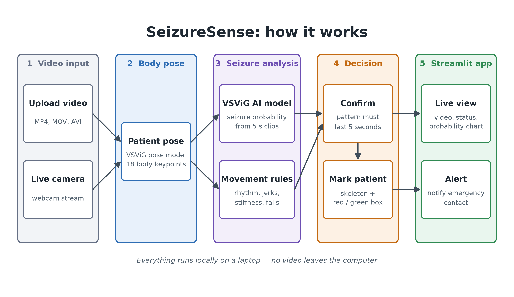

# SeizureSense

SeizureSense watches a video of a person in bed, live from a webcam or from an uploaded file. If their movement looks like a seizure, it raises an alert.

Built by the **Atomic Chickens** team at **Stoller Middle School**.

[](https://www.youtube.com/watch?v=dd-mZ79hgOs)

▶️ **Demo video:** https://www.youtube.com/watch?v=dd-mZ79hgOs

> SeizureSense is a student project, not a medical device. Don't rely on it to keep anyone safe.

## How it works



1. **Video input.** Upload a video (MP4, MOV, AVI or MKV), or switch on the live camera.
2. **Body pose.** A pose model tuned on patients in hospital beds finds 18 body keypoints in each frame.
3. **Seizure analysis.** Two checks run side by side:
   - the **VSViG deep-learning model**, which turns 5-second clips into a seizure probability
   - hand-written **movement rules**, which look for rhythmic jerking, sudden jerks, stiffness and falls
4. **Decision.** A seizure is confirmed only when the pattern lasts about 5 seconds. The patient gets a green or red box and a skeleton drawn over them.
5. **Streamlit app.** The app shows the annotated video, the seizure status and a probability chart, and the alert names the emergency contact.

Everything runs on your own computer, and no video is uploaded anywhere. See [docs/TECH_STACK.md](docs/TECH_STACK.md) for the full list of libraries and models.

## Run it

You need Python 3.12. The models use the Apple GPU (MPS) or an NVIDIA GPU (CUDA) when one is available, and otherwise fall back to the CPU.

```bash
uv venv --python 3.12
```

```bash
uv pip install -r requirements.txt
```

```bash
.venv/bin/streamlit run app.py
```

Then open http://localhost:8501. Use the sidebar to upload a video or switch on **Live Video**, and to set up the emergency contact.

You can also run the detector without the web app, using your webcam in an OpenCV window. Press `q` to quit and `r` to reset.

```bash
.venv/bin/python seizure_detection.py
```

## Project layout

| Path | What's in it |
|---|---|
| `app.py` | Streamlit web app: sidebar, video upload, live camera, status, chart and emergency contact |
| `seizure_detection.py` | Pose detection, VSViG inference, movement rules and the `SeizureDetector` that combines them |
| `VSViG/` | Model code and pretrained weights from the VSViG authors (`pose.pth`, `VSViG-base.pth`, `dy_point_order.pt`) |
| `lwopenpose/` | Lightweight OpenPose network code, which runs the pose model |
| `assets/` | Logo |
| `docs/` | Architecture diagrams and the tech stack |

## Acknowledgements and attribution

Our deep-learning approach is inspired by, and uses the pretrained models from, the VSViG paper and its code. We thank the authors for publishing their work openly.

- **Paper:** Yankun Xu, Junzhe Wang, Yun-Hsuan Chen, Jie Yang, Wenjie Ming, Shuang Wang and Mohamad Sawan. *VSViG: Real-Time Video-Based Seizure Detection via Skeleton-Based Spatiotemporal ViG.* European Conference on Computer Vision (ECCV), 2024. [arXiv:2311.14775](https://arxiv.org/html/2311.14775v2)
- **Code and pretrained weights:** [github.com/xuyankun/VSViG](https://github.com/xuyankun/VSViG/), Apache License 2.0. The `VSViG/` folder contains their model code, the patient pose model (`pose.pth`) and the seizure model (`VSViG-base.pth`), with their [LICENSE](VSViG/LICENSE).
- **Pose network:** Daniil Osokin, [Lightweight OpenPose](https://github.com/Daniil-Osokin/lightweight-human-pose-estimation.pytorch) ("Real-time 2D Multi-Person Pose Estimation on CPU: Lightweight OpenPose", 2018), Apache License 2.0. The `lwopenpose/` folder contains its code, with its [LICENSE](lwopenpose/LICENSE).

The movement rules, the decision logic and the Streamlit app are our own work.

If you build on the deep-learning part of this project, please cite the VSViG paper:

```bibtex
@inproceedings{xu2024vsvig,
  title={VSViG: Real-Time Video-Based Seizure Detection via Skeleton-Based Spatiotemporal ViG},
  author={Xu, Yankun and Wang, Junzhe and Chen, Yun-Hsuan and Yang, Jie and Ming, Wenjie and Wang, Shuang and Sawan, Mohamad},
  booktitle={European Conference on Computer Vision},
  pages={228--245},
  year={2024},
  organization={Springer}
}
```
