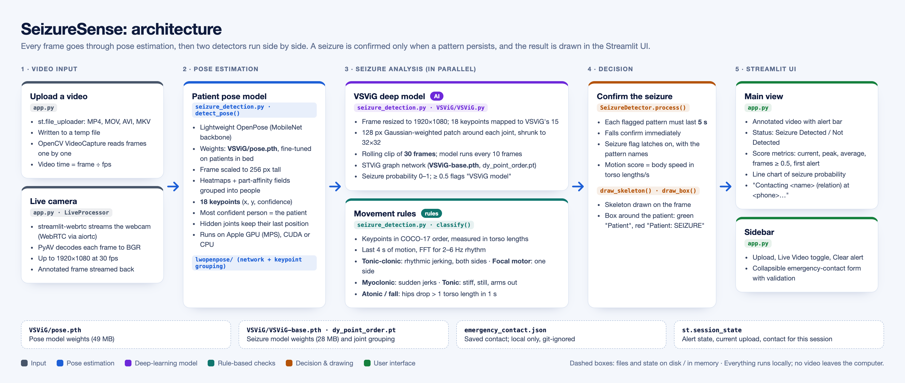

# SeizureSense tech stack

**Language and runtime:** Python 3.12. Everything runs on the local computer. The AI models use the Apple GPU (MPS) when available, otherwise an NVIDIA GPU (CUDA) or the CPU.

## Web app

| Library | Version | What it does here |
|---|---|---|
| **Streamlit** | 1.66.1 | The whole web UI: page layout, sidebar, file upload, status, metrics, chart, emergency-contact form. Stores alert and contact state per browser session. |
| **streamlit-webrtc** | 0.79.0 | Live camera mode: streams the webcam to the server and sends annotated frames back to the browser. |
| **aiortc** | 1.15.0 | The WebRTC connection underneath streamlit-webrtc. Installed automatically. |
| **PyAV** (`av`) | 17.1.0 | Converts live-camera frames to and from images the detector can use. |

## Video and math

| Library | Version | What it does here |
|---|---|---|
| **OpenCV** (headless) | 5.0.0 | Reads uploaded videos frame by frame, resizes images, cuts the patches around each joint, and draws the skeleton, box and alert bar. |
| **NumPy** | 2.5.4 | Keypoint math: body-relative coordinates, speeds, and the FFT that finds 2–6 Hz rhythmic jerking. |

## AI / deep learning

| Library | Version | What it does here |
|---|---|---|
| **PyTorch** | 2.14.1 | Runs both neural networks. |
| **torchvision** | 0.29.1 | Image transforms used by the VSViG code. |
| **timm** | 1.0.30 | Model-registration helper that the VSViG code imports. |

## Models

| Model | Weights | Details |
|---|---|---|
| **Patient pose model**: Lightweight OpenPose with a MobileNet backbone | `VSViG/pose.pth` (49 MB) | Fine-tuned by the VSViG authors on patients in hospital beds. Takes a frame scaled to 256 px tall and outputs 18 body keypoints per person. Code is in `lwopenpose/`, from [lightweight-human-pose-estimation.pytorch](https://github.com/Daniil-Osokin/lightweight-human-pose-estimation.pytorch) (Apache 2.0). |
| **VSViG seizure model**: STViG graph network, base size | `VSViG/VSViG-base.pth` (28 MB) and `dy_point_order.pt` | From Xu et al., ECCV 2024 ([VSViG](https://github.com/xuyankun/VSViG), Apache 2.0). Looks at 30 frames of 15 joints, each as a 32×32 image patch plus its position. Outputs a seizure probability from 0 to 1; 0.5 or above flags a seizure. |
| **Movement rules** | none (hand-written) | Checks for tonic-clonic, focal motor, myoclonic, tonic and atonic/fall patterns from how the joints moved over the last 4 seconds. |

## Storage

- **Model weights:** stored in the repo under `VSViG/`.
- **Emergency contact:** `emergency_contact.json` in the project folder, git-ignored.
- **Everything else:** Streamlit session state in memory.

There's no database, no cloud service, and no account system. The "Account Name" in the sidebar is a placeholder.

## Dev tooling (not part of the app)

- **uv** to create the `.venv` and install packages.
- **Playwright** driving Chrome, to test the app in a browser and render `architecture.png`.

## Not in the stack yet

- A messaging service (e.g. Twilio) to actually call or text the emergency contact. Today the app only shows a "Contacting…" message.
- Anything for saving a history of past alerts.
